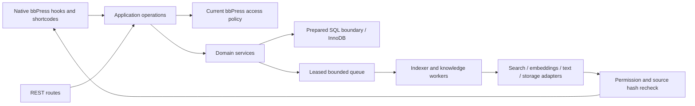

# Architecture

The platform is a modular monolith. WordPress/bbPress remain the source of truth for posts, statuses, membership and capabilities. Custom tables hold derived state and interactions. Neither bbPress nor WordPress core is modified.

## Boundaries

`Bootstrap/Services` composes contracts and feature flags. `Application/Operations` owns operation dispatch and conservative payload validation. `Integration/BbPress/Access` authorizes current objects, ancestor forums, passwords, inactive users and BuddyPress groups. A nonce proves request origin, never permission.

`Infrastructure/Database/Store` whitelists table identifiers and prepares request-derived values. Transaction nesting is supported within the same Store instance; nested transactions across separate instances must not be assumed. Current sensitive reads are not shared across viewers. Request caches include blog identity and authorization is checked after cache retrieval.

Search retrieves bounded candidates; source posts and opt-in field values are reloaded before rendering. Hybrid retrieval never sends restricted forum composer context to an external embedding provider. Duplicate prevention always uses local lexical retrieval.

Text, embedding, vector, search, attachment and realtime contracts permit trusted adapters. Contract mismatches degrade to bundled local/null adapters. Large installations should replace the portable vector candidate scan and benchmark their indexed backend.

## Queue

Unique job keys coalesce source updates; revision counters preserve updates arriving during an active lease. Claims use row locks, 180-second leases and random lease tokens. Completion/error updates are fenced by token. Runs are limited to 20 seconds between jobs and at most 100 jobs; bundled AI network calls have configurable 1–30 second timeouts (15 seconds by default). Push jobs process one device each. Five transport failures produce a dead job; quota deferrals wait for the next UTC day without consuming retries.

Administrative retries are capability guarded. A worker is at-least-once; external email/push can duplicate if a worker crashes after delivery and before committing delivery state. Do not promise exactly-once remote delivery.

## Compatibility

Boot happens after bbPress registers its APIs. Network activation enables lazy per-blog table and scheduler provisioning. Network deactivation clears each site's owned hooks. Native bbPress 2.6.19 calls a deprecated BuddyPress member-domain helper; the adapter replaces only that known filter integration when the current BuddyPress member URL API exists.

Refer to [ADRs](adr/0001-modular-monolith.md), [security](SECURITY.md) and [operations](OPERATIONS.md) for decisions and limits.

Discovery ranks only current readable, unmuted candidate topics. Its activity and reply counts come from bounded native evidence rows that are reauthorized before contributing; inaccessible/muted/spam replies and blocked/inactive signal owners cannot boost a visible parent topic. Known positive signals and distinct participants are evaluated within the current request. Raw bbPress reply-count metadata is not a privacy-safe input to ranking. Candidate topic windows are 100, with up to 2,000 recent-ID signal rows and 2,000 native published reply rows; these bounded samples are not lifetime totals.

`Notifications/NativeMentions` constrains only BuddyPress activities of native bbPress topic/reply types in the bbpress/groups components. Group activity resolves its source through secondary_item_id and validates the forum/group association. A pre-parser reset clears stale temporary recipients only for scoped activity; a post-parser guard applies current permission/preferences and bounded publication quotas, and a pre-delivery recheck handles access changes between save phases. A WeakMap prevents duplicate service registration from consuming the same save's quota twice without skipping authorization on later saves. BuddyPress retains its parser, count storage and email preferences; ordinary native activity is unaffected.
